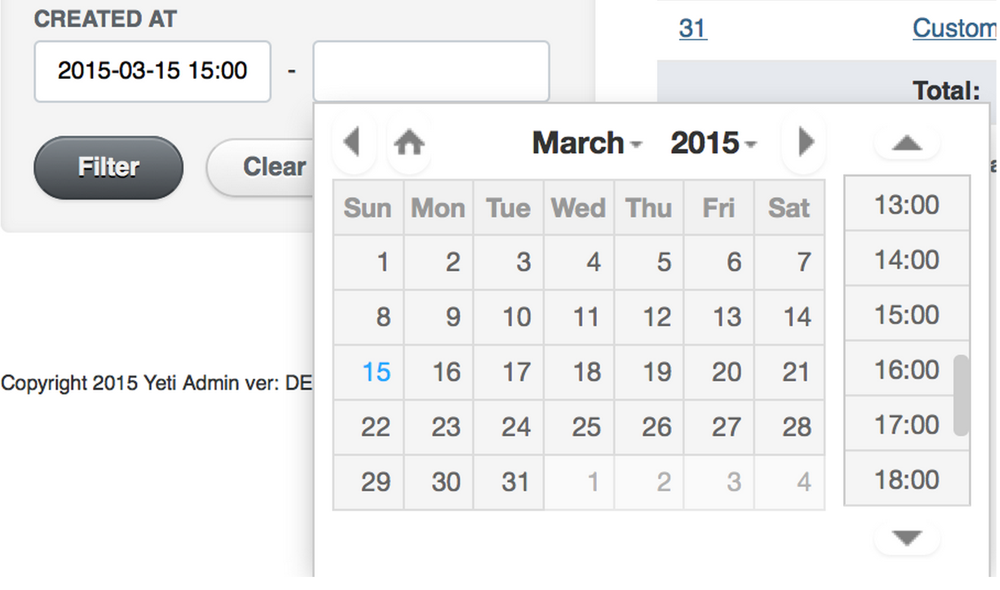

[](http://badge.fury.io/rb/active_admin_datetimepicker)
[](https://badge.fury.io/js/@activeadmin-plugins%2Factive_admin_datetimepicker)

[](https://github.com/activeadmin-plugins/active_admin_datetimepicker/actions/workflows/ci.yml)


# ActiveAdminDatetimepicker

Adds XDSoft's DateTime picker as a `date_time_picker` input for forms, and `date_time_range` for filters.

On ActiveAdmin 4 the same inputs render the browser's native date and time controls instead; see [ActiveAdmin 4](#activeadmin-4).



## Installation

Add this line to your application's `Gemfile`:

```ruby
gem 'active_admin_datetimepicker'
```

And then execute:

    $ bundle

Or install it yourself as:

    $ gem install active_admin_datetimepicker

##### Using assets via Sprockets
Add the following line into `app/assets/stylesheets/active_admin.scss`:

```css
@import "active_admin_datetimepicker";
```

Add the following line into `app/assets/javascripts/active_admin.js`:

```javascript
//= require active_admin_datetimepicker
```

##### Using assets via NPM/Yarn

Execute:

    $ npm i @activeadmin-plugins/active_admin_datetimepicker

Or

    $ yarn add @activeadmin-plugins/active_admin_datetimepicker

Or add manually to `package.json`:

```
"dependencies": {
  "@activeadmin-plugins/active_admin_datetimepicker": "latest"
}
```
and execute:

    $ yarn

Add the following line into `app/assets/javascripts/active_admin.js`:

```javascript
import '@activeadmin-plugins/active_admin_datetimepicker';
```

Add the following line into `app/assets/stylesheets/active_admin.scss`:

```css
@import '@activeadmin-plugins/active_admin_datetimepicker';
```

## Usage

This plugin adds the `date_time_picker` input and `date_time_range` filter, which use the [XDSoft DateTime Picker](https://github.com/xdan/datetimepicker/).

The `date_time_picker` input accepts many of the options available to the standard jQueryUI Datepicker. For example:

```ruby
  # Index page filters
  filter :created_at, as: :date_time_range

  # New/Edit form
  form do |f|
    f.input :starts_at, as: :date_time_picker, datepicker_options: { min_date: "2013-10-8",        max_date: "+3D" }
    f.input :ends_at,   as: :date_time_picker, datepicker_options: { min_date: 3.days.ago.to_date, max_date: "+1W +5D" }
  end
```

## ActiveAdmin 4

ActiveAdmin 4 ships without jQuery and Sprockets, so on ActiveAdmin 4 the gem
does not load the XDSoft picker. The `date_time_picker` input and the
`date_time_range` filter render native `<input type="datetime-local">` fields
(`type="date"` for a `date` column), styled by ActiveAdmin itself. There is no
JavaScript or CSS to install: skip the Sprockets and NPM steps above.

Values use the HTML format, `YYYY-MM-DDTHH:MM` (`YYYY-MM-DD` for date fields).
`ActiveAdminDatetimepicker::Base.format` applies to ActiveAdmin 3 only.

Only these `datepicker_options` (and `default_datetime_picker_options`) have a
native equivalent and are applied on ActiveAdmin 4. Everything else is ignored.

| Option | Native attribute |
| --- | --- |
| `min_date`, `min_date_time` | `min` |
| `max_date`, `max_date_time` | `max` |
| `step` (minutes) | `step` (seconds, `datetime-local` only) |

`min`/`max` must be absolute dates (a `Date`, `Time` or a string like
`"2024-01-31"`); relative values such as `"+3D"` are dropped. An explicit
`input_html: { min: ... }` wins over the mapped value.

The markup carries `data-*` hooks for tests and other plugins:

- every input: `data-datetimepicker-input`
- the filter wrapper: `data-datetimepicker-range` (on ActiveAdmin 4 it also keeps the `filter_date_time_range` class)
- the filter inputs: `data-datetimepicker-range-input="from"` and `"to"`

## Override behaviour in initializer

```ruby
# This if for the front-end JavaScript side
ActiveAdminDatetimepicker::Base.default_datetime_picker_options = {
    defaultDate: proc { Time.current.strftime("%Y-%m-%d 00:00") }
}
# This if for the Ruby backend
ActiveAdminDatetimepicker::Base.format = "%Y-%m-%d %H:%M:%S"
```

## Change datetime format

If you want to change the format you need to make sure that front-end and back-end formats are identical.
And remember JS and Ruby datetime format have different syntaxes.

Create configuration file `config/initializers/init_datetimepicker.rb`:

```ruby
# Example "11/03/2016 13:00"
ActiveAdminDatetimepicker::Base.default_datetime_picker_options = {
    format: 'd/m/Y H:i', # JS format
    defaultTime: proc { Time.current.strftime('%H:00') } # not necessary
}
ActiveAdminDatetimepicker::Base.format = "%d/%m/%Y %H:%M" # Ruby format
```

See [the datetimepicker documentation for more details](http://xdsoft.net/jqplugins/datetimepicker/).

## Theming

### Accent color

The upstream XDSoft stylesheet hardcodes a bright blue (`#33aaff`) on the
selected/current day, the current time slot and "today". This gem exposes that
color as a single SCSS variable so you can recolor the whole picker without
`!important` overrides. Set it **before** importing the gem; the default keeps
the original blue, so existing apps are unaffected:

```scss
$aa-datetimepicker-accent-color: #38678b; // your brand color
@import "active_admin_datetimepicker";
```

### Dark mode

The picker follows the host's dark theme using the same triggers as
[`active_admin_theme`](https://github.com/activeadmin-plugins/active_admin_theme):
the OS `prefers-color-scheme: dark` preference and an explicit
`html[data-theme="dark"]`. Under either, the picker adopts XDSoft's built-in
`.xdsoft_dark` skin (its orange current/today, dark surfaces). A page pinned
with `html[data-theme="light"]` always stays light. No configuration is needed;
it works out of the box once the gem's stylesheet is imported.

Note: in dark mode the current/today cells use XDSoft's built-in dark skin
colors, not `$aa-datetimepicker-accent-color`.


## Contributing

1. Fork it ( https://github.com/activeadmin-plugins/active_admin_datetimepicker/fork )
2. Create your feature branch (`git checkout -b my-new-feature`)
3. Commit your changes (`git commit -am 'Add some feature'`)
4. Push to the branch (`git push origin my-new-feature`)
5. Create a new Pull Request
